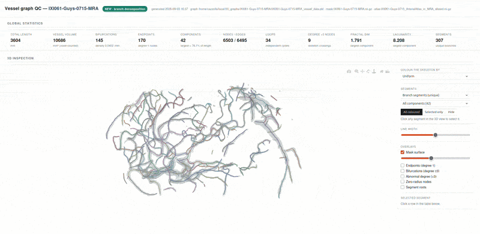

# Caravel-Metrics

This branch contains an updated version of the original CaravelMetrics framework. For detailed instructions on how to run it, check [docs/USAGE.md](docs/USAGE.md).

Differences with the original branch are detailed below.

<!-- Logo/Banner Image -->
<p align="center">
  
</p>

**[An Automated Framework for Large-Scale Graph-Based Cerebrovascular Analysis](https://arxiv.org/abs/2512.03869)** (Arxiv)

**Accepted at ISBI2026!**

[](https://www.python.org/downloads/)
[](https://opensource.org/licenses/MIT)
[](link-to-paper)

CaravelMetrics is an open-source Python framework for comprehensive, automated analysis of cerebrovascular networks from medical imaging data. It transforms binary vessel segmentation masks into quantitative morphometric, topological, and geometric features across anatomically defined brain territories.

---

## 🎯 Overview

Understanding cerebrovascular morphology is critical for detecting disease and distinguishing pathological changes from normal aging. CaravelMetrics enables large-scale population studies by automating vessel feature extraction through graph-based analysis.

<!-- Pipeline Diagram -->
<p align="center">
  
</p>


### Key Capabilities

- **Modular Architecture**: Four independent processing stages (Atlas Registration, Graph Extraction, Metric Computation, Interactive Quality Control)
- **Interactive 3D Quality Control**: Visual inspection of vessel graphs and segmentation surfaces with dynamic filtering and summary statistics
- **Batch & Single-Subject Processing**: Pipelines for single scans or cohort execution
- **Automated Graph Construction**: Converts vessel segmentation masks to graph representations via skeletonization
- **Multi-Scale Feature Extraction**: Morphometric, topological, geometric and fractal features per component, segment, junction and atlas region (see [FEATURES.md](docs/FEATURES.md))
- **Dual Analysis Modes**: Whole-brain and atlas-based regional analysis across 30 brain territories
- **Population-Level Studies**: Validated on 570 subjects (ages 20-86) from the IXI dataset
- **Reproducible & Extensible**: Automation from raw masks to statistical analysis, with support for external graph formats

---

## 🆕 What's New

Main changes compared to the original CaravelMetrics release:

### 1. Interactive 3D Quality Control (QC) Reports (`QC_report.py`)
- **Interactive 3D visualization**: Self-contained HTML reports displaying 3D vessel skeletons overlaid with segmentation surfaces.
- **Metric dashboard**: Summary statistics for the whole graph and individual segments.
- **Batch mode**: Supports generating reports for single subjects or entire cohorts.

<p align="center">
  
</p>

### 2. Unique Branch Segment Decomposition
- **Segment decomposition**: Shifted from root-path overlapping segments to clean, non-overlapping **unique branch segments** (bifurcation-to-bifurcation, bifurcation-to-endpoint, endpoint-to-endpoint).
- **Exact metric alignment**: Eliminates statistical double-counting and bias in segment-level morphometrics (length, curvature, tortuosity), ensuring consistency between CSV outputs and QC reports.

### 3. Graph Extraction & Preprocessing (`Graph_extractor.py`)
- **Hole-filling**: Automatically fills internal segmentation cavities prior to skeletonization, preventing artificial loops.
- **Isotropic resampling**: Ensures uniform physical voxel spacing and consistent geometric measurements across scans.
- **Spur pruning**: Prunes terminal branch hairs (`--min_branch_len`, default 2.0 mm) created by skeletonization noise without eroding small vessels.

### 4. Volume Computation & Universal Graph Input Support (`Metric_extractor.py`)
- **Exact voxel-counted volume**: Computes true regional volumes directly from the binary mask (`--mask`), or uses a truncated cone (conical frustum) approximation along graph edges instead of a simple cylinder.
- **Graph loader**: Native support for external graph formats, including NetworkX `.pkl`, UNC trees, and MetaIO / TubeTK `.tre` files.

### 5. Multi-Modal Registration (`Atlas_Registration.py`)
- **Redesigned registration pipeline**: Replaced the original binary mask to MRA registration with an intensity-based approach (registering subject T1 to MRA and MNI template to T1, or direct MNI-to-MRA template warping).
- **Direct FSL execution**: Removed Nipype overhead, running FSL directly via subprocess with optional 2D multi-slice QC snapshots (`--registration_snapshot`).
- **Optional T1 modality**: Supports dual-modality registration (MRA + T1) when available, or falls back to direct MNI-to-MRA registration.
- **Preprocessing controls**: Integrated ANTs denoising and N4 bias correction flags (`--preprocess_mra`, `--preprocess_t1`) and pre-stripped input options (`--mra_stripped`, `--t1_stripped`).

---

## 🚀 Quick Start

```bash
# 1. Clone and install
git clone https://github.com/i-vesseg/CaravelMetrics.git
cd CaravelMetrics
pip install -r requirements.txt

# 2. Run the full pipeline (core graph extraction + regional atlas + interactive QC)
python CaravelMetrics.py \
  --image subject001_MRA.nii.gz \
  --mask  subject001_vessel_mask.nii.gz \
  --t1    subject001_T1.nii.gz \
  --output_dir results/ \
  --html_qc

# 3. Or run the core pipeline only (whole-graph metrics, no atlas / no FSL required)
python CaravelMetrics.py \
  --image subject001_MRA.nii.gz \
  --mask  subject001_vessel_mask.nii.gz \
  --output_dir results/ \
  --no_atlas

# 4. Extract graph only
python Graph_extractor.py \
  --mask subject001_vessel_mask.nii.gz \
  --output_dir results/

# 5. Compute metrics only
python Metric_extractor.py \
  --graph results/subject001_vessel_mask_vessel_data.pkl \
  --out_dir results/
```

For detailed instructions, command-line arguments, running individual stages, and batch scripts, see **[docs/USAGE.md](docs/USAGE.md)**.

---

## 📚 Documentation

**Full documentation and usage examples are available in [`docs/`](docs/)**

- **[Usage Guide](docs/USAGE.md)** - Comprehensive guide to end-to-end execution, individual stages, and batch scripts
- **[Pipeline Overview](docs/PIPELINE.md)** - Processing steps and modular architecture
- **[Installation Guide](docs/INSTALLATION.md)** - Detailed setup instructions and prerequisites
- **[Features Documentation](docs/FEATURES.md)** - Detailed feature definitions and mathematical formulation
- **[Analysis Guide](docs/ANALYSIS.md)** - Statistical analysis and population-level workflows

---

## 📄 Citation

Details will be provided after acceptance.

---
## 📜 License

This project is licensed under the MIT License - see the [LICENSE](https://opensource.org/license/mit) file for details.

---

## 🙏 Acknowledgments

This work is co-funded by:
- **European Research Council** (ERC CARAVEL 101171357)
- **ANR JCJC I-VESSEG** (22-CE45-0015-01)
- **TwinsUK Imaging**: A Resource for Ageing Research (Chronic Disease Research Foundation)
- **King's Health Partners Digital Health Hub** and **EPSRC**

### Data and Resources

- **IXI Dataset**: https://brain-development.org/ixi-dataset/
- **Arterial Atlas**: Liu et al., Scientific Data (2023) - https://doi.org/10.1038/s41597-022-01923-0
- **VesselVerse**: [Falcetta et al., MICCAI (2025)](https://papers.miccai.org/miccai-2025/paper/0087_paper.pdf) - Vessel segmentation resource. [(Official Website)](https://i-vesseg.github.io/vesselverse/)

---

## 👥 Authors

- **Daniele Falcetta** - Data Science Department, EURECOM
- **Liane S. Canas** - School of Biomedical Engineering & Imaging Sciences, King's College London
- **Lorenzo Suppa** - Data Science Department, EURECOM & Politecnico di Torino
- **Matteo Pentassuglia** - Data Science Department, EURECOM
- **Jon Cleary** - School of Biomedical Engineering & Imaging Sciences, King's College London
- **Marc Modat** - School of Biomedical Engineering & Imaging Sciences, King's College London
- **Sébastien Ourselin** - School of Biomedical Engineering & Imaging Sciences, King's College London
- **Maria A. Zuluaga** - Data Science Department, EURECOM & School of Biomedical Engineering, King's College London

## 🤝 Contributors

- **Bogdan Ion** - Data Science Department, EURECOM
- **Duccio Lalli** - Double Degree MSc Student in Data Science and Engineering at Politecnico di Torino & EURECOM
- **Mattia Cazzolla** - Data Science Department, EURECOM

---

### Contact

For questions about the code or research collaborations:
- Open an issue on GitHub
- Email: daniele.falcetta@eurecom.fr, maria.zuluaga@eurecom.fr

---
